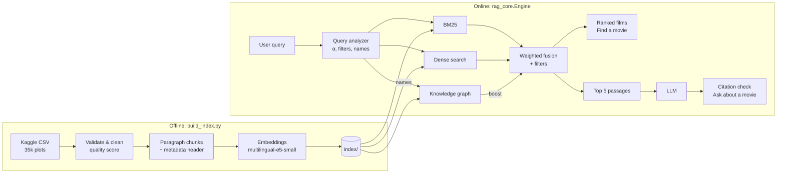
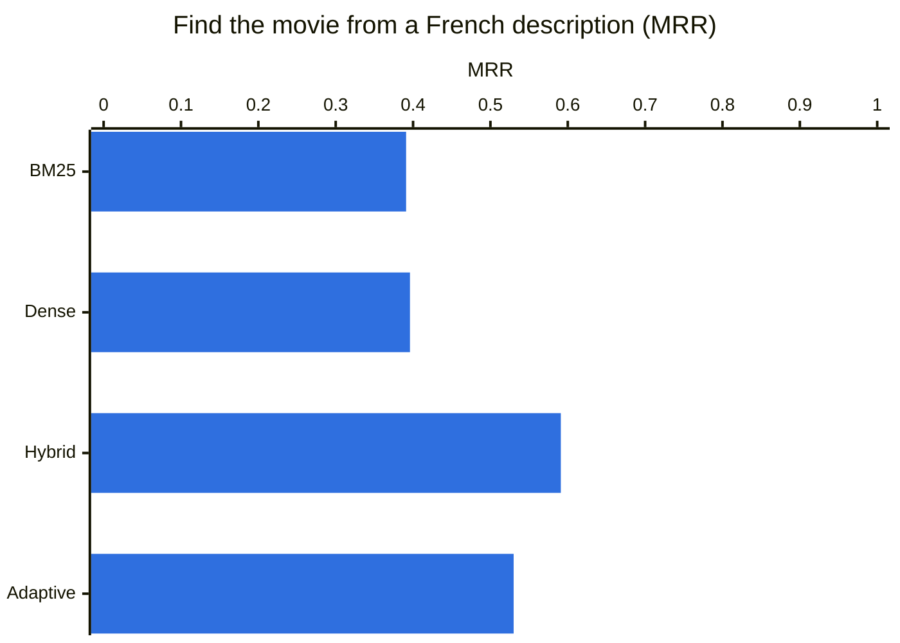
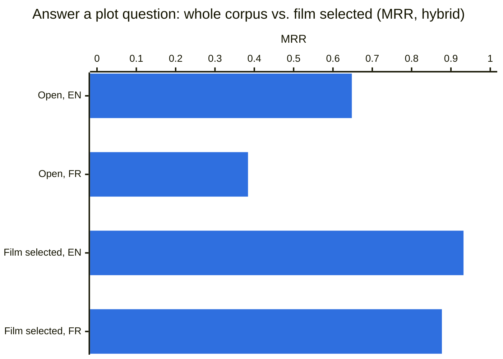

# Tip of the Tongue: movie RAG

**Describe a film you half-remember, get it back, then ask questions about its plot and get answers that cite their sources.**

"the movie where a weatherman keeps reliving the same day" → *Groundhog Day*. Works in English and French, over ~35k Wikipedia plots, on a laptop CPU.


## Highlights

- **Hybrid search, built from scratch:** a BM25 index written in numpy plus multilingual embeddings, with a query analyzer that decides per query how much to trust each one.
- **Grounded answers:** a local LLM (Llama 3.1 8B through Ollama) answers only from the retrieved passages, and every citation is checked against what was actually retrieved.
- **Knowledge graph:** films, people and genres in a graph that boosts films by a named director or actor and powers "more like this" (personalised PageRank).
- **Measured, not guessed:** 600 evaluation queries, each in English and French, compare 4 retrieval modes, 3 chunking strategies and 3 embedding models.
- **Production habits:** data validation before indexing, incremental re-embedding, per-stage latency logging and a monitoring dashboard.

**Stack:** Python · Streamlit · sentence-transformers (multilingual-e5) · NumPy · NetworkX · Ollama / OpenAI-compatible APIs · pandas

## Architecture



| Step | What happens |
|---|---|
| **Validate** | Strips `[1]`/`[citation needed]` markers, repairs broken encoding, scores each plot's quality. Drops duplicates and plots under 25 words (1,942 of 35k). |
| **Chunk** | Splits plots on paragraphs (40–220 words) and prefixes each chunk with title, year, director and genre so both retrievers can match on them. |
| **Analyze query** | Picks the dense weight α: 0.3 if the query names a person or quotes a title, 0.9 if it isn't English, 0.6 for a vague description. Extracts filters such as "90s", "Bollywood" or "horror". |
| **Fuse** | Normalises BM25 and dense scores and combines them as `α · dense + (1 − α) · bm25`. A film scores as well as its best passage. |
| **Generate** | Sends the top 5 passages to the LLM at temperature 0, with instructions to answer only from them and cite each one as `[movie_id#n]`. |
| **Check** | Flags citations to passages the model never saw, and answers with no citations. |

## Results

Evaluated on 10k films with 300 "find the movie" queries (plot sentences with names masked) and 300 DuoRC plot questions, each also machine-translated to French. Metric: MRR (1.0 = the right answer is always ranked first).





- **Hybrid beats either retriever alone** wherever the task isn't saturated. With French queries it scores 0.59, against 0.39–0.40 for BM25 or dense alone.
- **Letting the user pick the film matters most:** MRR goes from about 0.63 to 0.93.
- **The adaptive α doesn't beat a fixed 0.5 yet.** Its weights are hand-set; learning them is the next step.
- **multilingual-e5-small** was the best embedding model on CPU. `nomic-embed-text` collapses on French, and `e5-base` is 3× slower to embed.

<details>
<summary>Full results tables</summary>

**Find the movie (MRR, English / French)**

| Chunking | BM25 | Dense | Hybrid α=0.5 | Adaptive |
|---|---|---|---|---|
| whole film | 1.000 / 0.351 | 0.277 / 0.213 | 0.998 / 0.513 | 0.878 / 0.393 |
| paragraph | 1.000 / 0.385 | 0.428 / 0.292 | 1.000 / 0.538 | 0.888 / 0.474 |
| fixed 150 words, 30 overlap | 1.000 / 0.391 | 0.565 / 0.396 | 1.000 / 0.591 | 0.889 / 0.530 |

BM25's perfect English score is an artifact: the queries reuse the plot's wording almost exactly. The French column is the realistic one.

**Answer a plot question (MRR, paragraph chunking, English / French)**

| Mode | Whole corpus | Film selected |
|---|---|---|
| BM25 | 0.628 / 0.266 | 0.919 / 0.827 |
| Dense | 0.393 / 0.248 | 0.892 / 0.863 |
| Hybrid | 0.648 / 0.384 | 0.932 / 0.877 |
| Adaptive | 0.628 / 0.358 | 0.939 / 0.867 |

**Embedding models (dense only, fixed chunking, English / French)**

| Model | Find the movie | Plot question |
|---|---|---|
| nomic-embed-text-v1.5 | 0.486 / 0.099 | 0.265 / 0.084 |
| **multilingual-e5-small** | **0.565 / 0.396** | 0.375 / 0.253 |
| multilingual-e5-base | 0.503 / 0.248 | **0.424 / 0.292** |

Generated answers were not scored yet (answer F1 and invented-citation rate). Details are in [`notebooks/evaluation.ipynb`](notebooks/evaluation.ipynb).

</details>

## The app

Three tabs, plus a sidebar whose settings apply to both search tabs.

| Sidebar | |
|---|---|
| **Mode** | `adaptive` (the analyzer chooses), `hybrid` (fixed α slider), `dense` or `bm25` |
| **Results / Graph boost** | number of films returned; +0.5 for films linked to a person named in the query (marked 🕸️) |
| **Filters** | year range, origin, genre; these override filters found in the query |
| **LLM backend** | `ollama` (local), `openai` (any OpenAI-compatible server) or `none` (passages only) |

**🔎 Find a movie.** Type a description or click an example. Each result shows the best-matching passage with query words highlighted, the score, the full plot with a Wikipedia link, five related films from the graph, and a button that opens the film in the Ask tab. The metrics row shows α, the filters applied, retrieval time and why the analyzer chose that α.


**💬 Ask about a movie.** Pick a film (or search all of them) and ask in any language. The answer cites its passages, a check confirms every citation is real, and the sources are listed below so you can verify them.


**📊 Monitoring.** Every query is logged with its mode, α, filters and per-stage latency. The tab shows median and p95 retrieval time, LLM time, queries per mode, the recent query log and the ingestion validation report.


<details>
<summary>Monitoring: query log and validation report</summary>


</details>

## Run it

```bash
python3.11 -m venv .venv && source .venv/bin/activate
pip install -r requirements.txt

kaggle datasets download -d jrobischon/wikipedia-movie-plots -p data --unzip
python build_index.py --csv data/wiki_movie_plots_deduped.csv --n-movies 10000   # ~8-10 min on CPU

ollama pull llama3.1:8b      # optional: without it, set the backend to "none"
streamlit run app.py
```

Rebuilds are incremental: only new or changed chunks are re-embedded. `--n-movies 0` indexes all ~35k films; `--model` switches the embedding model.

## Project structure

| File | Role |
|---|---|
| `rag_core.py` | Validation, chunking, BM25, dense search, query analyzer, fusion, knowledge graph, LLM backends, logging |
| `build_index.py` | Offline pipeline that writes `index/` and the validation report |
| `app.py` | Streamlit UI |
| `notebooks/evaluation.ipynb` | Experiments: chunking, retrieval modes, cross-lingual queries, embedding models |

## Next steps

- Learn α from query features instead of hand-set values.
- Rerank the top 50 with a cross-encoder and measure the gain against latency.
- Score generated answers: token F1 against DuoRC and the invented-citation rate.
- Move to FAISS or Qdrant for the full 35k-film index.
