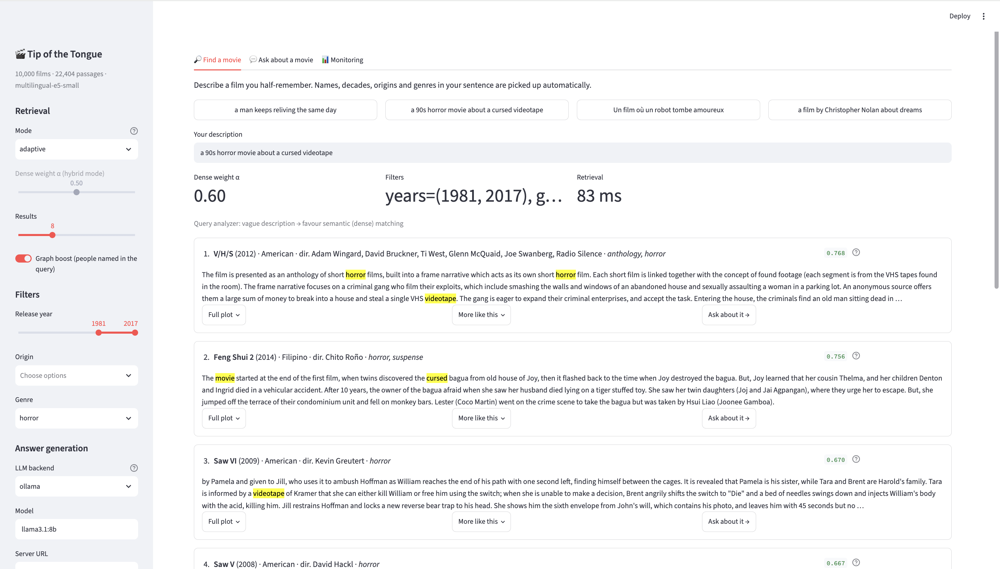
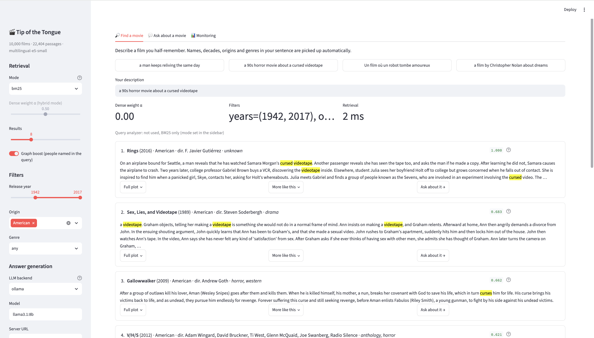
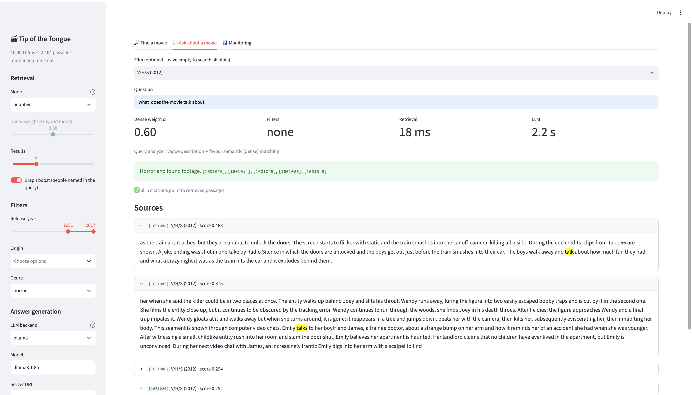
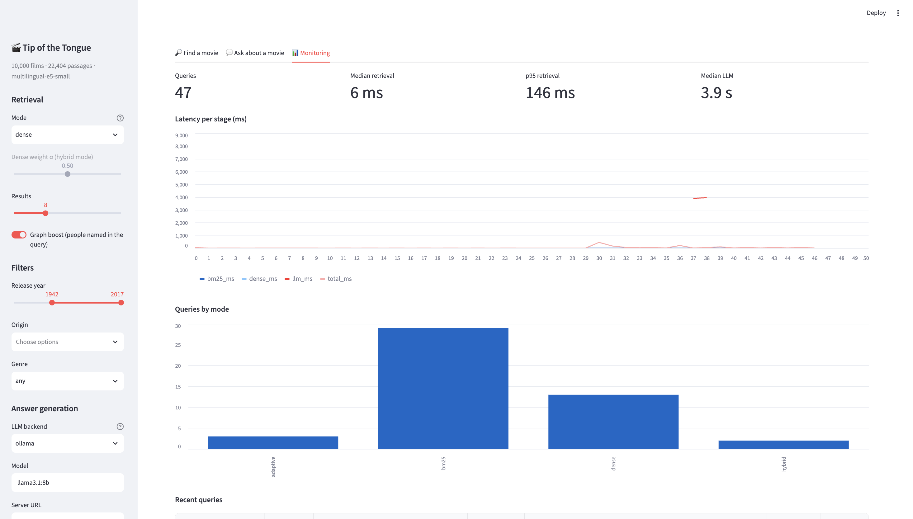
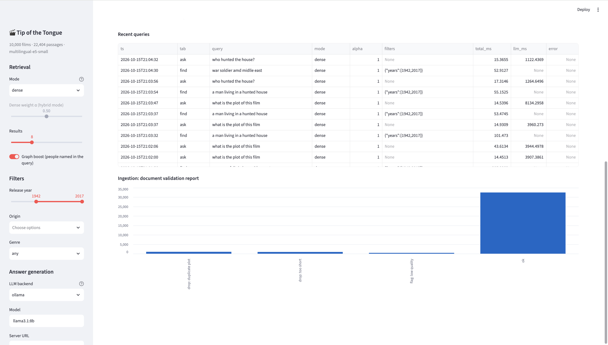

# Tip of the Tongue: movie RAG

Describe a film you half-remember ("the movie where a weatherman keeps reliving the same day") and get it back, then ask questions about its plot and get answers that cite the passages they came from.

The corpus is the Kaggle [Wikipedia Movie Plots](https://www.kaggle.com/datasets/jrobischon/wikipedia-movie-plots) dataset (~35k films). Retrieval is a hybrid of BM25 and dense embeddings, weighted per query, with metadata filters pulled out of the query text and a small knowledge graph over directors, actors and genres. Generation is optional and runs on a local LLM through Ollama or any OpenAI-compatible server.

The experiments behind the design choices are in [`notebooks/evaluation.ipynb`](notebooks/evaluation.ipynb).

## Using the app

`streamlit run app.py` opens a page with a sidebar of settings and three tabs: **Find a movie**, **Ask about a movie** and **Monitoring**. The sidebar settings apply to both search tabs.

### Sidebar

The header shows what's loaded: number of films, number of passages and the embedding model.

**Retrieval**

| Setting | What it does |
|---|---|
| Mode | `adaptive` (default): the query analyzer chooses the dense weight α and pulls filters out of the query text. `hybrid`: fixed α from the slider below. `dense`: embeddings only (α = 1). `bm25`: keyword matching only (α = 0). |
| Dense weight α | Weight on dense scores in `hybrid` mode; disabled in the other modes. |
| Results | Number of films returned by **Find a movie** (3–20). |
| Graph boost | If the query names a director or actor, films linked to them in the knowledge graph get a +0.5 bonus (marked 🕸️). |

**Filters.** Release year range, origin (one or more, such as American, Bollywood or Japanese) and genre. Sidebar filters always apply and override any filter the analyzer finds in the query. In the Ask tab they only apply when no film is selected. If a filter matches nothing, it's ignored and the analyzer note says so.

**Answer generation.** The LLM backend: `ollama` (local, default `llama3.1:8b`), `openai` (any OpenAI-compatible server: OpenAI, LM Studio, vLLM, Groq; takes a server URL and API key) or `none` (retrieval only, no generated answer).

### Find a movie

Type a description of the film, or click one of the four example queries (one is in French, to show cross-lingual search). Above the results, a row of metrics shows the dense weight α that was used, the filters that were applied and the retrieval time. Below it, a note explains the analyzer's choice, such as "vague description → favour semantic (dense) matching", or says it wasn't used because the mode was set in the sidebar.

Each result shows:

- rank, title, year, origin, director and genre, with the fused score on the right (🕸️ if the graph boost applied);
- the film's best-matching passage, with query words highlighted (stemmed, so "curses" matches "cursed"; stop words are ignored);
- **Full plot**: the whole cleaned plot and a link to the Wikipedia article;
- **More like this**: five related films found by personalised PageRank over shared directors, actors and genres;
- **Ask about it →**: selects the film in the Ask tab.

In adaptive mode, the analyzer reads "a 90s horror movie about a cursed videotape" as a vague description and sets α = 0.6. Here the year range and genre come from the sidebar:



The same query in `bm25` mode with the origin set to American. α is 0 and the note says the analyzer wasn't used:



### Ask about a movie

Pick a film (or leave it on "All films" to search every plot) and ask a question in any language. The top 5 passages go to the LLM, which must answer only from them and cite each passage it uses as `[movie_id#n]`. The metrics row adds the LLM's response time.

Below the answer, the app checks the citations:

- ✅ all citations point to passages that were actually retrieved;
- ⚠️ the answer cites a passage it was never given (an invented citation);
- ⚠️ the answer cites nothing, so it can't be checked.

The **Sources** list shows each retrieved passage with its id and score, with question words highlighted, so you can check the answer yourself. If the LLM server can't be reached, or the backend is `none`, you still get the passages.



### Monitoring

Every search and question is logged to `logs/queries.jsonl`. This tab reads the log and shows:

- the number of queries, median and p95 retrieval time, and median LLM time;
- latency per stage (BM25, dense, LLM, total) for each query;
- the number of queries per retrieval mode;
- the 50 most recent queries with their tab, mode, α, filters and timings;
- the ingestion validation report: how many documents were kept, flagged or dropped, and why.

The embedding model loads when the app starts, so the first search is as fast as the rest.





## Setup

```bash
python3.11 -m venv .venv && source .venv/bin/activate
pip install -r requirements.txt

# 1. Get the dataset into data/
kaggle datasets download -d jrobischon/wikipedia-movie-plots -p data --unzip

# 2. Build the index (validation, chunking, embeddings). ~8-10 min for 10k films on a laptop CPU.
python build_index.py --csv data/wiki_movie_plots_deduped.csv --n-movies 10000

# 3. (optional) local LLM for generated answers
ollama pull llama3.1:8b

# 4. Run the app
streamlit run app.py
```

Rebuilding is incremental: only new or changed chunks are re-embedded. Use `--n-movies 0` for the full ~35k films and `--model` to switch embedding models (for example `nomic-ai/nomic-embed-text-v1.5`). Changing the model re-embeds everything.

Without an LLM, set the backend to `none` in the sidebar. Search and passage retrieval still work; you just get the passages instead of a written answer.

## Architecture

```
                         OFFLINE (build_index.py)
 ┌──────────────┐   ┌─────────────────┐   ┌──────────────┐   ┌──────────────────┐
 │ Kaggle CSV   │──▶│ Validation &    │──▶│ Paragraph    │──▶│ Embeddings       │
 │ ~35k plots   │   │ quality scoring │   │ chunking +   │   │ multilingual-e5  │
 └──────────────┘   └─────────────────┘   │ meta header  │   │ (incremental)    │
                            │             └──────────────┘   └──────────────────┘
                            ▼                                         │
                  validation_report.csv            index/ (movies.pkl, chunks.json,
                                                           embeddings.npy, meta.json)
                                                                      │
                         ONLINE (rag_core.Engine)                     ▼
 ┌────────┐   ┌────────────────┐   ┌──────────────────────────────────────────┐
 │ query  │──▶│ Query analyzer │──▶│ BM25 (in-memory)    Dense (cosine)       │
 └────────┘   │ alpha, filters,│   │      └──── min-max, α-weighted sum ────┘ │
              │ people, lang   │   │            metadata filter mask          │
              └────────────────┘   └──────────────────────────────────────────┘
                      │                                │
                      │ people                         ▼
                      ▼                     ┌──────────────────────┐
              ┌──────────────────┐          │ chunk scores         │
              │ Knowledge graph  │─ bonus ─▶│  ├─ max-pool → films │──▶ "Find a movie"
              │ film–person–genre│          │  └─ top-k chunks ──┐ │
              │ (PageRank: more  │          └────────────────────│─┘
              │  like this)      │                               ▼
              └──────────────────┘          ┌──────────────────────────────┐
                                            │ LLM (Ollama / OpenAI-compat) │──▶ "Ask about a movie"
                                            │ answer + [chunk_id] cites    │    + citation check
                                            └──────────────────────────────┘
```

### 1. Ingestion and validation

Wikipedia plots are messy, so every document is cleaned and scored before it is indexed (`rag_core.validate`):

- **Cleaning:** strips citation markers (`[1]`, `[citation needed]`, `[edit]`), repairs cp1252/UTF-8 mojibake, normalises whitespace and paragraph breaks.
- **Profiling:** word count, ratio of alphabetic characters, how many of director/cast/genre are missing, duplicate plots, duplicate title+year.
- **Quality score** in [0, 1]:
  `0.4 · min(words/150, 1) + 0.3 · clip((alpha_ratio − 0.6)/0.2) + 0.3 · (1 − missing_meta/3)`
- **Decision:** under 25 words → dropped, duplicate plot → dropped, quality < 0.6 → kept but flagged.

On the full dataset this gives 32,506 ok, 1,005 duplicate plots dropped, 937 too-short plots dropped and 438 flagged; 6,499 citation markers were removed. The per-film report is written to `index/validation_report.csv` and shown in the app.

### 2. Chunking

Each plot is split on Wikipedia paragraphs: paragraphs shorter than 40 words are merged with the next one, and anything longer than 220 words is split. Each chunk gets a metadata header:

```
Groundhog Day (1993) · American · dir. Harold Ramis · comedy
Phil Connors, a cynical Pittsburgh TV weatherman ...
```

The header puts title, year, director and genre into every chunk, so both BM25 and the embedding model can match on them. Chunk ids are `movie_id#n` and are what the LLM cites.

Ten thousand films come to about 23k chunks with a median of 230 words, which fits comfortably in the embedding model's 512-token window.

### 3. Retrieval

**BM25, written from scratch** (`rag_core.BM25`): an inverted index of numpy posting lists, with k1 = 1.2, b = 0.75, a stop-word list and a light suffix stemmer. It's rebuilt in memory at startup, which takes a few seconds for 23k chunks.

**Dense:** `intfloat/multilingual-e5-small` by default, with L2-normalised embeddings, so a dot product gives the cosine. The model-specific prefixes (`query:` / `passage:` for e5, `search_query:` / `search_document:` for nomic) are applied automatically. Getting these wrong costs recall without any error message. The embedding matrix is a plain `.npy` scanned with a matrix-vector product, which is fast enough at this scale (about 20 ms per query).

**Query analyzer** (`rag_core.QueryAnalyzer`): reads the query and decides how much to trust each retriever (α is the weight on dense):

| Query contains | α | Why |
|---|---|---|
| a known person name or a quoted title | 0.3 | exact strings, so lexical matching wins |
| non-English text | 0.9 | BM25 can't match across languages |
| only a vague description | 0.6 | paraphrase, so semantic matching wins |

It also extracts **self-query filters**: decades ("90s", "the 1980s"), years ("from 1994"), origin ("a Bollywood film", "Japanese") and genre ("a horror movie"). The people, origin and genre vocabularies are built from the indexed data, not hard-coded. A filter that matches nothing is ignored instead of returning zero results. Filters chosen in the sidebar override the ones found in the query.

**Fusion:** both score vectors are min-max normalised and combined as `α · dense + (1 − α) · bm25`. Film-level ranking max-pools chunk scores, so a film scores as well as its best passage. The sidebar can force `bm25`, `dense`, `hybrid` (fixed α from the slider) or `adaptive`.

### 4. Knowledge graph

A bipartite `networkx` graph links films to people (directors and cast) and genres. For 10k films that's about 29k nodes and 53k edges. It's used two ways:

- **Entity boost:** if the query names a person who is in the graph, every film linked to them gets +0.5. This can also pull in a film the text search ranked too low to return. Boosted results are marked 🕸️ in the UI.
- **More like this:** personalised PageRank (damping 0.85) seeded on the selected film, so related films surface through shared directors, actors and genres.

### 5. Grounded generation

For a question, the top 5 chunks (restricted to one film if the user picked one) are sent to the LLM with this prompt:

```
Answer the question using ONLY the movie plot passages below.
After every sentence of your answer, cite the passages it comes from as [id], for example [123#0].
If the answer isn't in the passages, say "I don't know".
Answer briefly, in the language of the question.
```

Temperature is 0. After generation, every `[movie_id#n]` in the answer is checked against the ids that were actually retrieved, and any citation to a passage the model never saw is flagged in the UI. An answer with no citations at all is flagged too, since it can't be checked. Backends: Ollama (`/api/generate`), any OpenAI-compatible `/chat/completions` endpoint (LM Studio, vLLM, Groq, OpenAI), or none.

### 6. Monitoring

Each search and question is appended to `logs/queries.jsonl` with the chosen α, filters, number of results and per-stage latency (BM25, dense, LLM, total). The app's monitoring tab shows latency over time, the recent query log and the ingestion validation report.

## Evaluation

All numbers come from `notebooks/evaluation.ipynb`: 10k films, `multilingual-e5-small`, CPU.

**Task A, find the movie.** There are 300 synthetic queries. Each takes two sentences from the middle of a plot and masks proper nouns and title words with "someone" or "something". A third of them get a director hint ("A film by X."). Every query was also machine-translated to French (`Helsinki-NLP/opus-mt-en-fr`) to test cross-lingual retrieval against the English corpus.

**Task B, answer a plot question.** There are 300 [DuoRC](https://www.kaggle.com/datasets/thedevastator/duorc-a-dataset-of-movie-plots) SelfRC questions, joined to the corpus by normalised title, keeping only those whose gold answer appears verbatim in our copy of the plot. A retrieved chunk counts as relevant if it belongs to the right film and contains the answer. Each question is run *open* (whole corpus) and *filtered* (restricted to the right film, as when the user picks it in the UI).

### Task A: MRR

| Chunking | BM25 en / fr | Dense en / fr | Hybrid α=0.5 en / fr | Adaptive en / fr |
|---|---|---|---|---|
| whole film | 1.000 / 0.351 | 0.277 / 0.213 | 0.998 / 0.513 | 0.878 / 0.393 |
| paragraph | 1.000 / 0.385 | 0.428 / 0.292 | 1.000 / 0.538 | 0.888 / 0.474 |
| fixed 150w, 30 overlap | 1.000 / 0.391 | 0.565 / 0.396 | 1.000 / 0.591 | 0.889 / 0.530 |

### Task B: MRR, paragraph chunking

| Mode | Open en / fr | Filtered en / fr |
|---|---|---|
| BM25 | 0.628 / 0.266 | 0.919 / 0.827 |
| Dense | 0.393 / 0.248 | 0.892 / 0.863 |
| Hybrid | 0.648 / 0.384 | 0.932 / 0.877 |
| Adaptive | 0.628 / 0.358 | 0.939 / 0.867 |

### Embedding models: dense only, fixed chunking, MRR

| Model | Task A en / fr | Task B en / fr |
|---|---|---|
| nomic-embed-text-v1.5 | 0.486 / 0.099 | 0.265 / 0.084 |
| **multilingual-e5-small** | **0.565 / 0.396** | 0.375 / 0.253 |
| multilingual-e5-base | 0.503 / 0.248 | **0.424 / 0.292** |

### What the numbers say

- **BM25's perfect English score on Task A is an artifact.** The masked queries are lifted almost word for word from the plot, so lexical overlap is near total. The French column is the realistic one: BM25 drops to about 0.39 and hybrid holds up best at 0.54–0.59. That gap is the argument for mixing in dense retrieval at all.
- **Hybrid beats either retriever alone everywhere it isn't saturated**, in both tasks and both languages.
- **The adaptive α is not yet better than a fixed 0.5.** On Task A English it loses about 11 points of MRR to plain hybrid. Likely causes: it leans towards dense on vague queries even when they happen to be lexical, and genre words inside plot sentences ("drama", "war") can trigger a filter that shouldn't apply. The values in the analyzer table are hand-set, and learning them is the obvious next step.
- **The graph boost didn't change Task A results.** The likely reason is that many director hints use names the analyzer's n-gram matcher doesn't pick up, such as initials ("L. G. Ravichandran") or single names ("Visu"), so the boost never fires. It does work for full names such as "A film by Christopher Nolan".
- **Filtering to the right film is worth a lot.** Task B MRR goes from about 0.63 to about 0.93. In the UI that's the "restrict to this film" selector on the Ask tab.
- **Chunking:** smaller chunks help dense retrieval most, because long plots get truncated at 512 tokens with whole-film chunks. Fixed windows scored slightly higher than paragraphs on Task A. The app uses paragraphs, which give cleaner, self-contained passages to cite, at a small cost in recall.
- **Model choice:** `multilingual-e5-small` is the best trade-off on CPU. `nomic-embed-text` is English-only and collapses on French. `e5-base` is better at plot questions but worse at finding films, and about 3× slower to embed.
- **Generation was not scored.** Ollama wasn't running during the notebook run, so answer F1 and the invented-citation rate are still to be measured.

## Files

| File | Role |
|---|---|
| `rag_core.py` | Engine: validation, chunking, BM25, dense retrieval, query analyzer, hybrid search, knowledge graph, LLM backends, logging |
| `build_index.py` | Offline pipeline: writes `index/` and the validation report |
| `app.py` | Streamlit UI: Find a movie, Ask about a movie, Monitoring |
| `notebooks/evaluation.ipynb` | Experiments: chunking strategies, retrieval modes, cross-lingual queries, embedding benchmark |

## Next steps

- Learn α from data (a small classifier over query features) instead of hand-set values.
- Rerank the top 50 with a cross-encoder (`BAAI/bge-reranker-v2-m3`) and measure MRR gain against latency.
- Swap the numpy matrix for FAISS or Qdrant once the full 35k-film index gets slow.
- Score generation: token F1 against DuoRC answers and the rate of invented citations.
- Harder Task A queries: LLM-paraphrased descriptions that don't reuse the plot's wording.
